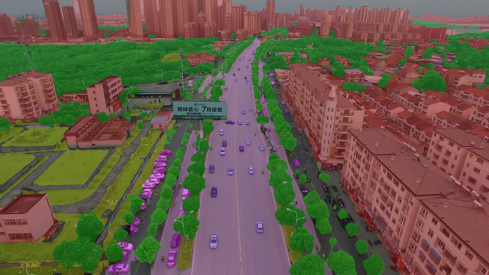
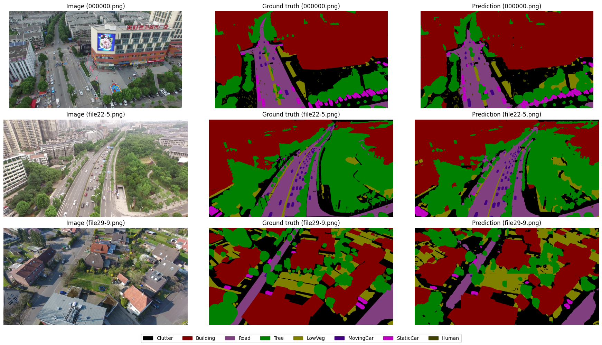
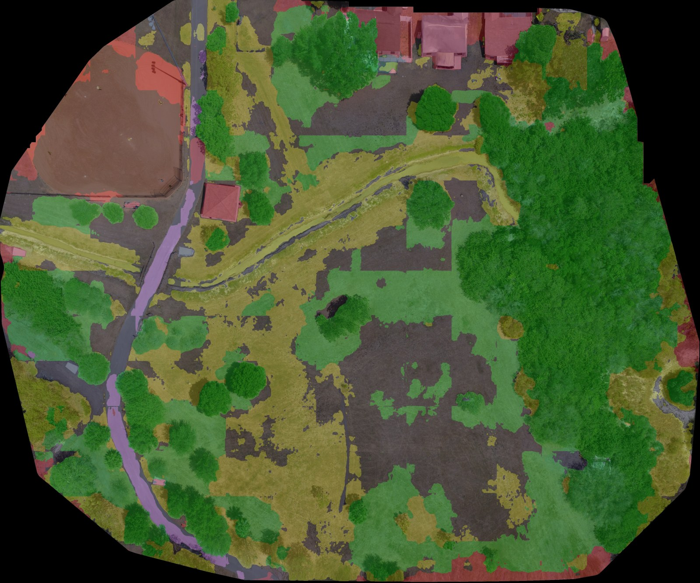
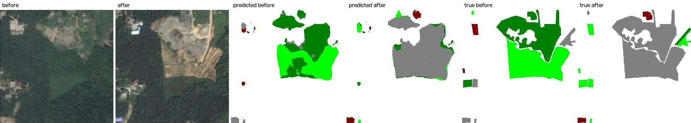
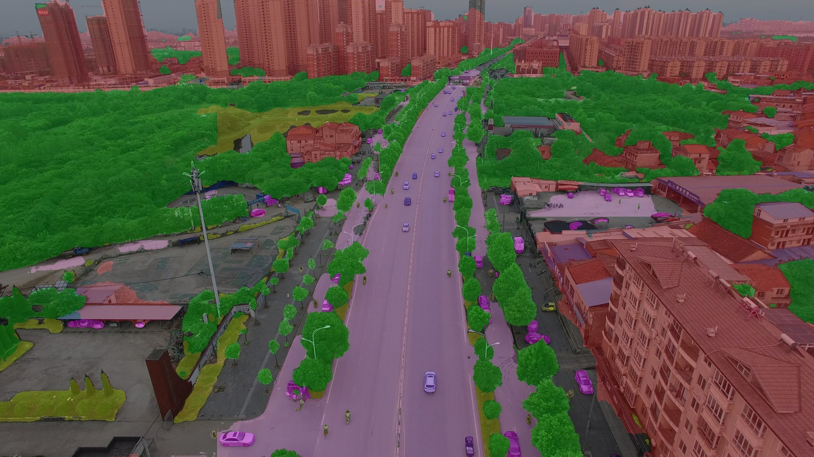
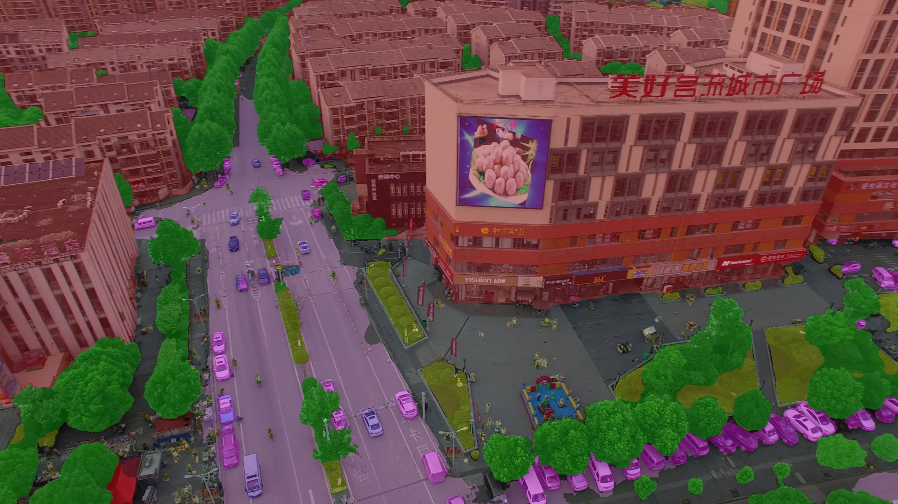

# Drone Mapping with Deep Learning

A drone mapping pipeline: a segmentation model labels every pixel of an aerial image as building, road, tree, low vegetation, car, human or clutter, those labels are turned into a georeferenced land-cover map of a whole area, and a Siamese network compares two images of the same place to find what changed between dates.



## Motive

Drones can survey an area much faster than ground teams, but raw footage is hard to use on its own. A map that shows where the buildings, roads, vegetation and vehicles are is far more useful for urban planning, disaster response and surveillance. I wanted to build that pipeline end to end, from training the model to producing a map with real-world coordinates.

## Objective

1. Train a segmentation model on drone images (done)
2. Turn predictions into a single labelled map of an area (done, first version)
3. Compare images of the same area over time to detect what changed (done, first version)

## Tech stack

Python, PyTorch, segmentation-models-pytorch, OpenCV, NumPy, rasterio, OpenDroneMap. Training on Google Colab and Kaggle (T4 GPU), everything else runs on CPU.

## Dataset

[UAVid](https://uavid.nl): 4K oblique drone images of urban scenes with 8 classes. I used the Kaggle mirror.

- 200 labelled training images and 70 validation images. The mirror also includes 400 pre-flipped and shifted copies of the training images. I left these out and used random augmentation during training instead.
- The test set has no public labels, so test frames are used only for visual results.
- Each image is downscaled to 1920x1080 and cut into 512x512 tiles, giving 2,400 training tiles and 840 validation tiles.

For mapping I used the Sheffield Park 3 sample set from [ODMdata](https://github.com/OpenDroneMap/ODMdata): 32 top-down photos of a park with GPS tags.

For change detection I used [SECOND](https://captain-whu.github.io/SCD): 512x512 aerial image pairs of the same place at two dates, with 6 land-cover classes (water, ground, low vegetation, tree, building, playground). Classes are only labelled where something changed; unchanged pixels are left blank. The download includes 2,968 training pairs and the official test set of 1,694 pairs. I held out 10% of the training pairs for validation.

## Model and training

- U-Net with a ResNet34 encoder pretrained on ImageNet
- Loss: Cross-Entropy + Dice (Dice helps with rare classes like Human)
- AdamW, learning rate 3e-4, cosine schedule, 30 epochs, batch size 8, mixed precision
- Augmentation: random flips, 90 degree rotations, brightness and contrast
- About an hour on a Colab T4

## Results

### Segmentation

Validation set (70 images, one video sequence), best epoch 27:

| Class | IoU |
|---|---|
| Building | 0.909 |
| Road | 0.787 |
| Tree | 0.769 |
| MovingCar | 0.761 |
| StaticCar | 0.682 |
| LowVeg | 0.679 |
| Clutter | 0.652 |
| Human | 0.399 |
| **Mean IoU** | **0.705** |

Pixel accuracy: 0.873



Notes on these numbers:

- The validation set comes from a single sequence, and the best epoch was picked on it, so the score is slightly optimistic. It is not comparable to the official UAVid test benchmark.
- Human is the weakest class. Humans make up only 0.12% of training pixels and become very small after downscaling.
- The most common error is confusing low vegetation with trees and clutter, which look similar from above.

### Land-cover map

The 32 photos were turned into an orthophoto with OpenDroneMap (about 8 minutes on CPU, 5 cm per pixel, UTM zone 17N). The model was then run on the orthophoto with 50% tile overlap, which removed the blocky seams that appeared at tile borders without overlap.



Estimated area of each class (about 1.5 minutes on CPU):

| Class | Share | Area (m²) |
|---|---|---|
| Tree | 43.4% | 12,285 |
| Clutter | 25.3% | 7,172 |
| LowVeg | 24.6% | 6,969 |
| Building | 5.3% | 1,488 |
| Road | 1.3% | 380 |
| Cars and Human | 0.0% | 4 |
| **Total** | | **28,298** |

There is no ground truth for this area, so these are the model's estimates, not measured accuracy. Looking at the map:

- Trees and roofs are labelled well.
- Building is overestimated. The houses cover a few hundred square metres, but the baseball diamond is also labelled Building, because UAVid has no class for bare ground.
- Most dry brown grass ends up as Clutter. UAVid grass is green, so the model does not recognise brown grass as low vegetation.
- No cars were found. UAVid shows cars at an angle, and they look different from straight above.

These come from training on oblique city footage and testing on top-down park photos. Fine-tuning on a top-down dataset would fix most of them.

### Change detection

Because SECOND only labels classes in changed areas, the two images have to be looked at together, so I built a Siamese U-Net:

- One shared ResNet34 encoder reads both images. It starts from the UAVid model above, and 276 of its 278 weight tensors are reused (only the final layer changes, from 8 to 6 classes).
- The U-Net decoder labels the land cover of each image.
- A small change head takes the absolute difference between the two images' features at every scale, merges them, and predicts changed or unchanged.
- Final output: where the change head says changed, the class before and the class after.
- Loss: cross-entropy for land cover (unchanged pixels ignored) plus binary cross-entropy and Dice for change. AdamW, learning rate 3e-4, cosine schedule, batch size 8, mixed precision, 10 epochs (about 1.5 hours on a Kaggle T4).

Results on the official test set (1,694 pairs, used once at the end; the best epoch was picked on validation):

| Metric | Val | Test |
|---|---|---|
| SeK | 0.215 | 0.199 |
| Fscd | 0.608 | 0.600 |
| mIoU (changed / unchanged) | 0.726 | 0.714 |
| Overall accuracy | 0.869 | 0.863 |
| Change precision | 0.745 | 0.719 |
| Change recall | 0.718 | 0.718 |
| Change F1 | 0.731 | 0.718 |

SeK and Fscd are the standard SECOND metrics. Both only reward a changed pixel when the class before and the class after are both right, which makes them much stricter than the plain change F1. I used the same formulas as the [Bi-SRNet](https://github.com/wdc233/Bi-SRNet) code.

For reference, the Bi-SRNet paper reports SeK 0.188 for HRSCD-str.4, 0.219 for SSCD-l and 0.232 for Bi-SRNet. Those were measured on a 593-pair split of the released data, not the official test set used here, so this is a rough comparison, not a ranking.


Columns: before, after, true labels before and after, predicted before and after. White = unchanged, grey = ground, dark green = low vegetation, bright green = tree, dark red = building, red = playground, blue = water.

What the results show:

- The changed / unchanged mask is the most reliable part. Precision and recall are both about 0.72.
- Most errors are in the class, not the location. 18% of true tree pixels are predicted as low vegetation, and ground and low vegetation are confused both ways (about 9% each). These look alike from above, and the two dates are often in different seasons.
- Building is the strongest class (recall 0.75). Water and tree are the weakest (recall 0.34). Water makes up only 0.25% of test pixels.
- Validation and test scores are close, so picking the best epoch on validation did not overfit.
- Scores were still rising at epoch 10, so longer training should help.
- I tried a post-processing rule: a pixel predicted as changed but given the same class on both dates is set to unchanged, since SECOND has no same-class changes. On the first 300 test pairs it raised change precision from 0.761 to 0.794 but lowered recall from 0.731 to 0.681, and SeK went from 0.233 to 0.230. Many of those pixels are real changes where only the class is wrong, so the rule is off by default (`--drop-same-class` in `change_detect.py`). These 300 pairs happen to be easier than the full test set, so the official scores are the ones in the table above.

More predictions on UAVid:




More Prediction on Change detection 
 


## Project structure

```
drone-mapping/
  assets/       images used in this README
  notebooks/
    01_data_setup.ipynb           download, inspect and tile UAVid (Colab)
    02_train_segmentation.ipynb   training and evaluation (Colab)
    03_change_detection.ipynb     change detection on Hi-UCD (prepared, not run yet: waiting for dataset access)
    04_second_change_detection.ipynb   Siamese U-Net change detection on SECOND (Colab or Kaggle)
  src/
    predict.py      run the model on full-size frames
    ortho_map.py    land-cover map from an ODM orthophoto, with coordinates and areas
    stitch.py       lightweight stitching of nadir photos without ODM
    siamese.py      Siamese U-Net model used for change detection
    change_detect.py   run the change detection model on image pairs (CPU), with scoring if labels exist
  models/       trained weights (not in the repo)
  data/         datasets and ODM projects (not in the repo)
  outputs/      predictions and maps (not in the repo)
```

## Setup

```
git clone https://github.com/AKASH4145/drone-mapping.git
cd drone-mapping
python -m venv .venv
.venv\Scripts\activate
pip install -r requirements.txt
```

The trained weights are not stored in the repo. Train your own with notebook 02 and place `unet_r34_best.pth` in `models/`.

For maps, install [OpenDroneMap](https://github.com/OpenDroneMap/ODM) (the native Windows installer works).

## Usage

### Predict on images

```
python src/predict.py --input path/to/images
```

Saves a colour mask and an overlay for each image to `outputs/predictions/`. If a matching `Labels` folder exists next to the images, it also prints the mIoU for each image. Takes about 6 seconds per 4K frame on CPU. Add `--overlap 0.5` to remove tile seams (about 4x slower).

### Land-cover map

1. Put the photos in `data/odm/<project>/images/` and run ODM from the ODM Console:
   ```
   run "full\path\to\data\odm\<project>" --fast-orthophoto --orthophoto-resolution 5
   ```
2. Segment the orthophoto:
   ```
   python src/ortho_map.py --input data/odm/<project>/odm_orthophoto/odm_orthophoto.tif
   ```

Outputs in `outputs/ortho_map/`: a label GeoTIFF with the same coordinates as the orthophoto (opens in QGIS with class colours), a colour mask, an overlay and a JSON file with the area of each class.

### Change detection

Training: open `notebooks/04_second_change_detection.ipynb` in Colab or Kaggle with a GPU and run all cells. It downloads SECOND, unpacks it, trains and saves the results. On Kaggle, attach `unet_r34_best.pth` as a dataset, turn on Internet, and use Save & Run All so it trains in the background.

Prediction (CPU is fine), with `second_siamese_best.pth` in `models/`:

```
python src/change_detect.py --before path/to/before.png --after path/to/after.png
python src/change_detect.py --pairs data/second/SECOND_total_test --limit 50
```

The two images must show the same area and be aligned. Larger images are processed in overlapping 512x512 tiles. `--pairs` takes any folder with `im1` / `im2` folders, and if `label1` / `label2` exist it also prints the SECOND scores. Results go to `outputs/change/`: a picture per pair and a JSON file with the share of changed pixels and the most common changes. Add `--pixel-size` (metres) to get areas in m².

### Stitching without ODM

```
python src/stitch.py --input data/nadir/sheffield_park_3
```

A simpler alternative I wrote to understand how stitching works. It matches SIFT features between every pair of photos, fits a similarity transform to each pair with RANSAC, then solves all transforms together with one least-squares problem so errors do not build up. Predictions are warped with nearest-neighbour interpolation so class ids are never blended. On Sheffield Park 3 the median alignment error is 2.3 px (95th percentile 7.1 px). It assumes flat ground and has no real-world coordinates, which is why the main pipeline uses ODM.

## Future plans

- Train the change detection model for longer (30 epochs) and add a loss that keeps unchanged areas consistent between dates
- Run change detection on Hi-UCD (10 cm aerial images) once access is approved, and compare it with the post-classification approach in notebook 03
- Apply change detection to two drone surveys of the same area
- Fine-tune the model on top-down drone images
- Pad image borders before predicting, so edge pixels are not mislabelled as Building

## Credits

UAVid dataset: Lyu et al., "UAVid: A semantic segmentation dataset for UAV imagery", ISPRS Journal of Photogrammetry and Remote Sensing, 2020.

Sheffield Park 3 images from the OpenDroneMap sample datasets.

SECOND dataset: Yang et al., "Semantic Change Detection with Asymmetric Siamese Networks", 2020 (arXiv:2010.05687).

Change detection metrics follow Ding et al., "Bi-Temporal Semantic Reasoning for the Semantic Change Detection in HR Remote Sensing Images", IEEE Transactions on Geoscience and Remote Sensing, 2022.

## Author

Akash G S | [GitHub](https://github.com/AKASH4145) | [LinkedIn](https://www.linkedin.com/in/akash-g-s-32aa15394/)